<div dir="rtl">

# Request Tracer

[](https://packagist.org/packages/ahmedhsieb/laravel-request-tracer)
[](https://github.com/ahmedhsieb/laravel-request-tracer/actions/workflows/ci.yml)
[](LICENSE)

**استبدل `dd()` بتتبّع كامل للطلب.**

`dd()` يعرض قيمة واحدة في مكان واحد ثم يقتل الطلب. أما Request Tracer فيسجّل **الطلب كاملاً** خطوة بخطوة، ويتيح لك فتح أي خطوة: ماذا دخل إليها، وماذا خرج منها، وأي أسطر نُفّذت، وأي صفوف كُتبت.

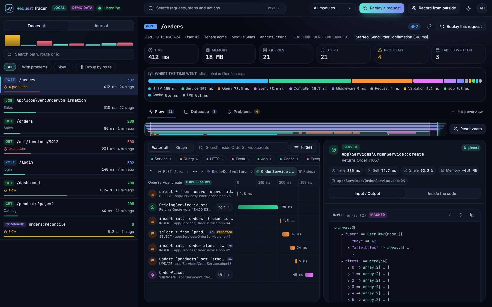

---

## التثبيت

```bash
composer require ahmedhsieb/laravel-request-tracer
```

هذا كل شيء. لا ملف إعدادات ولا migration ولا شيء تنشره: الجداول تُنشأ تلقائياً ولوحة التحكم تُقدَّم من الحزمة نفسها.

| المتطلبات | |
|---|---|
| PHP | 8.1 – 8.4 |
| Laravel | 10 و11 و12 و13 |
| قاعدة البيانات | MySQL / MariaDB أو PostgreSQL أو SQLite (لحفظ التتبّعات) |

تريد أن تتجوّل أولاً؟ شغّل `npm ci && npm run dev` داخل مجلد الحزمة فتفتح لوحة التحكم ببيانات تجريبية وبدون backend.

## ابدأ التتبّع

```bash
php artisan request-tracer:listen
```

استخدم تطبيقك كالمعتاد ثم افتح **`/request-tracer`**.

يعمل مثل `queue:work`: **طالما هو شغّال** يُتتبَّع كل ما يفعله المشروع (الطلبات، والـ jobs، وأوامر artisan، والمهام المجدولة) ويُطبع كل تتبّع في الطرفية. اضغط Ctrl+C فيتوقف. **وعندما لا يكون شغّالاً لا يُسجَّل أي شيء**، وتكلفة الحزمة من 25 إلى 65 ميكروثانية للطلب.

- **محلياً (local):** لوحة التحكم مفتوحة للجميع.
- **أي بيئة أخرى:** مغلقة (`403`) حتى تحدّد من يحق له فتحها، انظر [الإنتاج](#في-الإنتاج).

---

## المميزات

### المسار (Flow): كل ما فعله الطلب

الـ middleware والـ controller والتحقق والخدمات والاستعلامات واستدعاءات HTTP والأحداث والـ jobs والـ cache والسجلّات والاستثناءات، كل واحدة على **خط زمني** ببدايتها ومدتها الحقيقية. فوقها: الزمن والذاكرة والاستعلامات والمشاكل والجداول المكتوبة، و**أين ذهب الوقت** حسب نوع الخطوة. الشريط تحت التبويبات هو **خريطة الزمن**: اسحب عليه لتكبّر الخط الزمني على ذلك الجزء من الطلب.

مرّر الماوس على خطوة لمعاينتها، واضغط لتثبيتها. على اليمين **المدخلات والمخرجات** بتنسيق `dd()` مع إخفاء الأسرار.

### المجلدات: الطلبات العميقة تبقى مقروءة

أي خطوة بداخلها خطوات أخرى هي **مجلد**. تعرض القائمة مجلداً واحداً في كل مرة، فلا تُضغط الأسماء بسبب المسافات البادئة مهما كان الطلب عميقاً. افتح المجلد بالزر الذي في نهاية صفّه، وارجع للأعلى بالسهم، أو انتقل لأي مستوى من **المسار** فوق القائمة. والمحور الزمني يتبعك: المجلد المفتوح يعرض مدته هو.

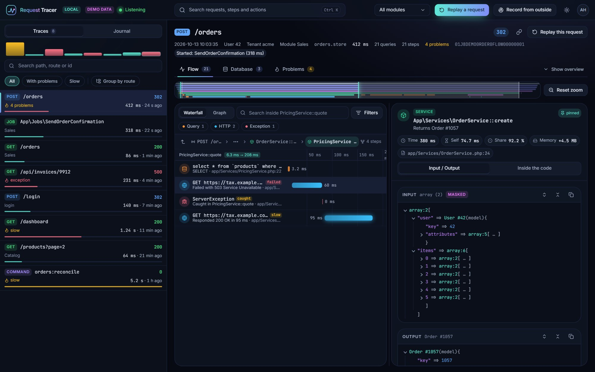

### البحث والفلاتر داخل المجلد

ابحث بالاسم أو الـ SQL أو الملف أو الملخص. وفلتر بالنوع (استعلام، HTTP، cache...) وبالسرعة (بطيء / سريع) وبالنتيجة (فشل / نجاح). تبحث الفلاتر في **كل ما تحت المجلد المفتوح** مهما كان عمقه، وتعرض النتائج مع المسار الذي توجد فيه كل واحدة. ومفتاح يحصرها في خطوات المجلد نفسه فقط.

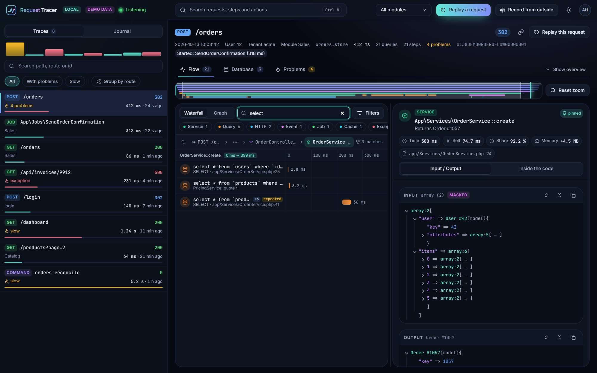

### عرض الرسم (Graph)

نفس الخطوات على شكل **أعمدة تنمو نحو اليمين**. اضغط على خطوة فيُفتح ما بداخلها في العمود التالي، ويبقى المسار الذي جئت منه على اليسار، والضغط على خطوة سابقة يرجعك إليها. سُمك الخط يساوي نصيب الخطوة من الوقت.

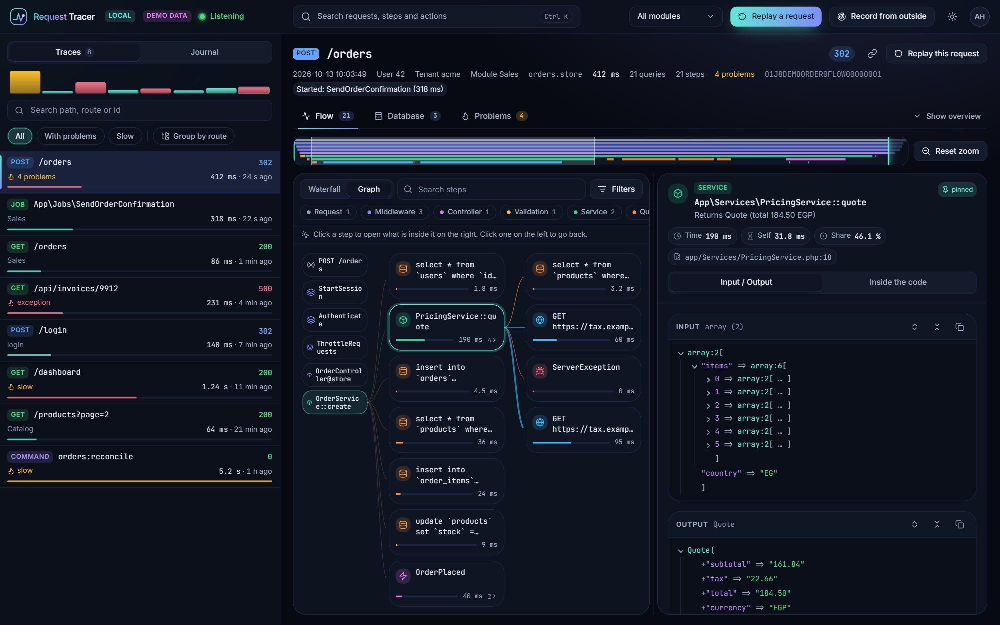

### داخل الكود، سطراً بسطر

كل شرط وكتلة ومتغيّر في الخطوة: أي `if` كان صحيحاً، وأي كتلة لم تُنفَّذ، وماذا كانت قيم المتغيرات. **مرّر الماوس على سطر** لترى ما حدث فيه، و**اضغط عليه** لتُبقي النافذة مفتوحة. زر **Replay** يمشي على الأسطر بترتيب تنفيذها. والدوال التي استدعتها الخطوة تظهر تحت السطر الذي استدعاها.

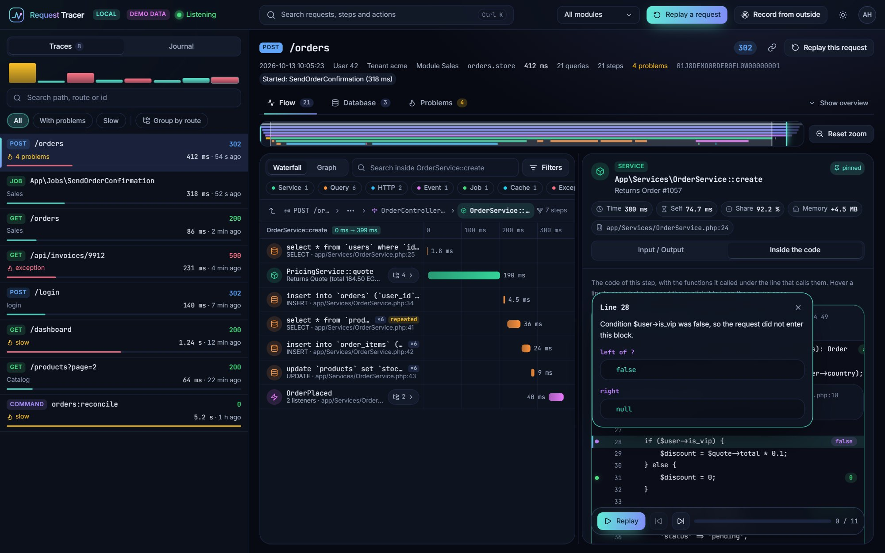

| النقطة | المعنى |
|---|---|
| خضراء | السطر نُفّذ |
| بنفسجية | شرط كان `false` |
| حمراء | السطر رمى استثناء |
| برتقالية | استثناء التُقط هنا |
| زرقاء | حلقة (مع عدد تكراراتها) |

### قاعدة البيانات: ماذا كتب الطلب

كل جدول غيّره الطلب: `INSERT` و`UPDATE` و`DELETE` والصفوف، ولكل تحديث **قبل ← بعد** مع تلوين الخلايا المتغيّرة. كل بطاقة تذكر الخطوة التي كتبت، وهل انتهت الـ transaction بـ commit أم rollback.

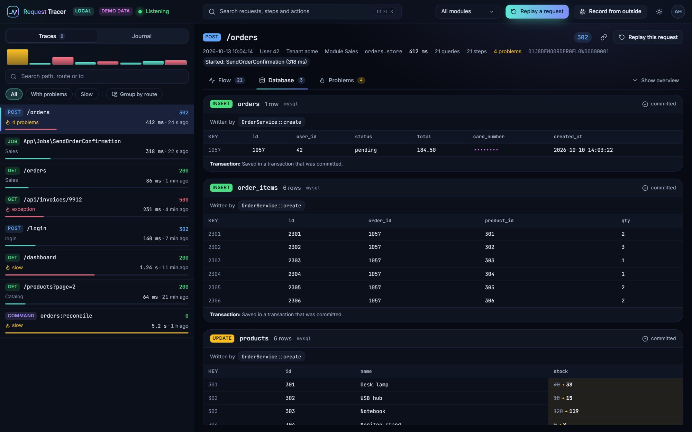

### المشاكل: تُكتشف لك

الاستثناءات (المرفوعة والملتقطة) و**استعلامات N+1** والاستعلامات المكرّرة أو البطيئة والخطوات البطيئة واستدعاءات HTTP الفاشلة، لكل منها شرح والملف والسطر ورابط للخطوة في المسار.

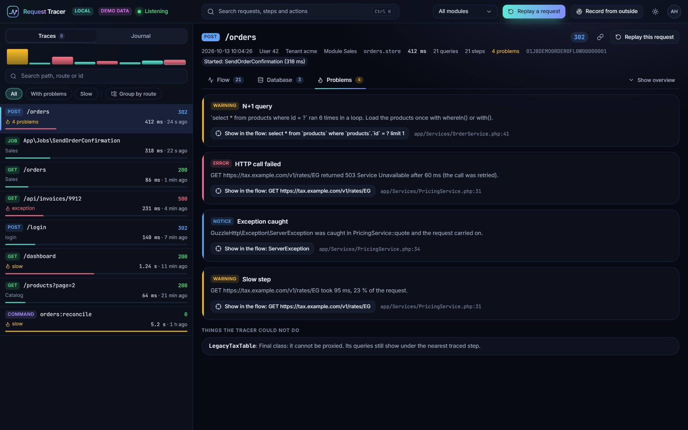

### إعادة التشغيل (Replay): شغّل الطلب مرة أخرى مع تتبّعه

لم يكن شيء يسجّل عندما حدث الطلب؟ شغّله مرة أخرى. من لوحة التحكم اضغط **Replay a request** والصق أمر cURL (في المتصفح: تبويب Network ثم *Copy as cURL*) أو صِف الطلب. وأنت تختار ما يحق له أن يغيّره:

| | محاكاة (الافتراضي) | تشغيل فعلي |
|---|---|---|
| قاعدة البيانات | يُتراجع عنها، لا يتغيّر شيء | التغييرات تُحفظ |
| الإيميلات والإشعارات والـ jobs واستدعاءات HTTP client | لا تخرج | تخرج |
| بعد ذلك | | **Undo** يُرجع كل كتابات Eloquent |

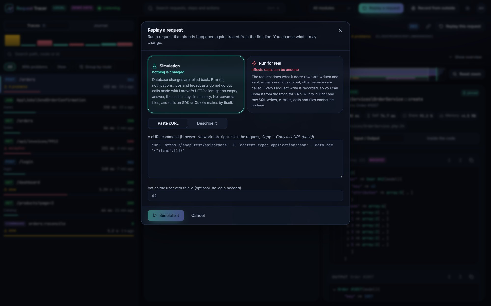

إعادة التشغيل مغلقة في بيئة `production` ما لم تفتحها، والتشغيل الفعلي هناك يحتاج مفتاحاً ثانياً.

### السجل (Journal): عندما لا تعرف أي طلب كان

فعّله (`REQUEST_TRACER_JOURNAL=true`) فيترك كل طلب سطراً خفيفاً (الرابط، والـ body بعد إخفاء الأسرار، والمستخدم، والحالة، والخطأ)، تُتبِّعه أو لا، لمدة ساعة. اختر الطلب الذي فشل فـ**يعيد تشغيل نفسه** بتتبّع كامل. و**Group by route** يجمع طلبات المسار الواحد معاً في القائمة وفي السجل.

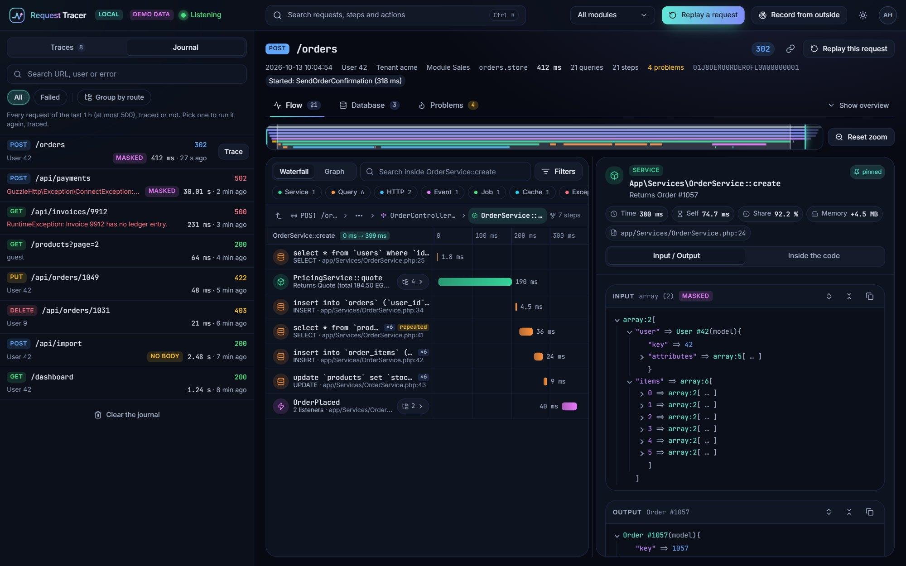

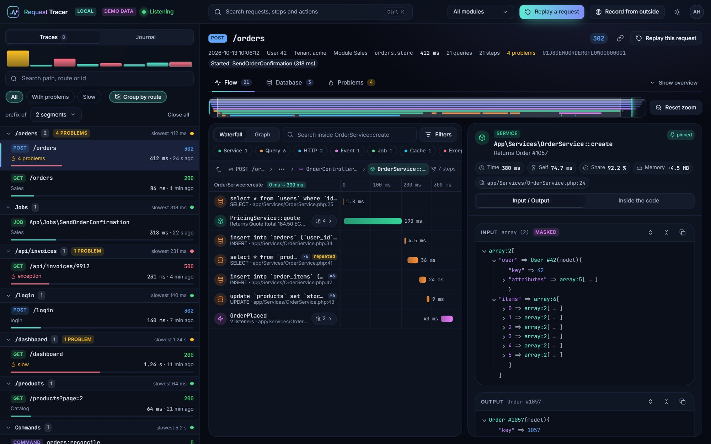

### وأيضاً في لوحة التحكم

- **Ctrl+K**: ابحث في الطلبات وفي خطوات الطلب المفتوح وفي الأوامر من لوحة المفاتيح.
- **Record from outside**: header موقّع لطلب واحد، أو مراقبة مستخدم لبعض الوقت، للخوادم التي لا تستطيع تشغيل الأمر عليها.
- **الـ jobs والأوامر**: الـ job الذي بدأه طلب يرتبط به، والعكس.
- **ثيم غامق وفاتح**، وأقسام يمكن تغيير حجمها، ويعمل على الشاشة الضيقة.

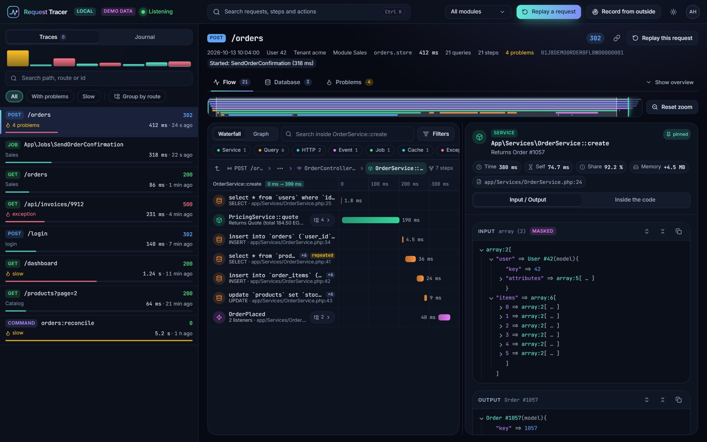

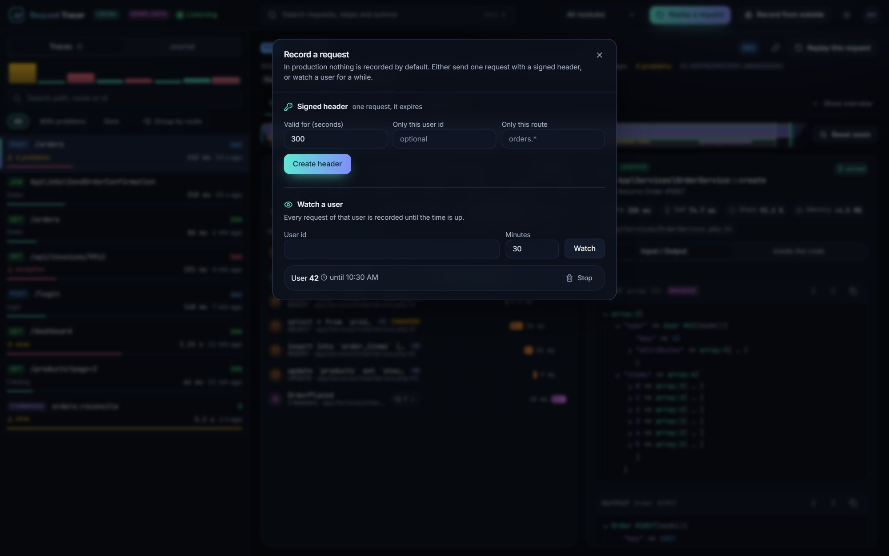

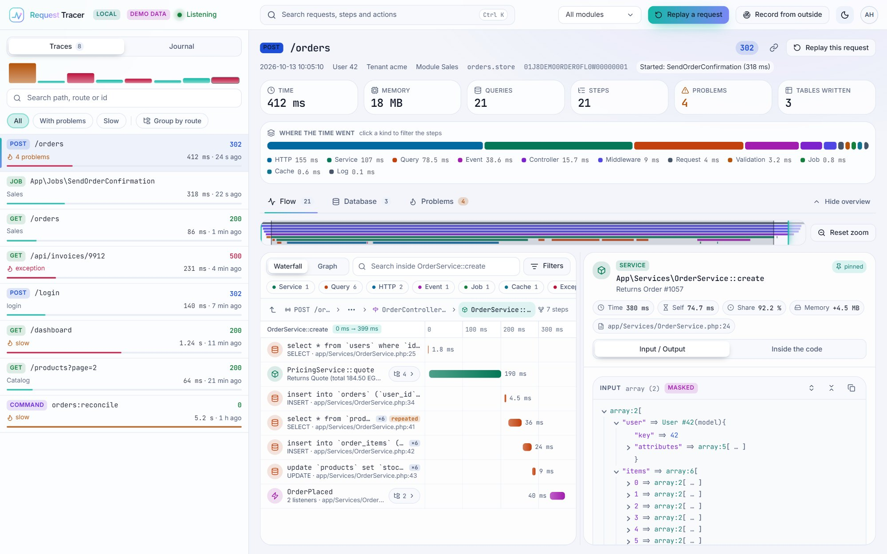

---

## الإعدادات

لا شيء تضبطه لتبدأ. لتغيير شيء انشر الملف واترك فيه المفاتيح التي تغيّرها فقط (لكل مفتاح قيمة افتراضية):

```bash
php artisan vendor:publish --tag=request-tracer-config
```

أهم المفاتيح:

| المفتاح | الافتراضي | ماذا يفعل |
|---|---|---|
| `code.paths` | `['app']` | المجلدات أو الملفات التي يُتتبَّع كودها سطراً بسطر. كل ما بداخلها يُتتبَّع، فلا تسرد الكلاسات. |
| `code.except` | `[]` | مجلدات أو ملفات أو كلاسات تُستثنى (`'app/Legacy'`, `'App\Reports\*'`). و`#[NoTrace]` على الكلاس يفعل الشيء نفسه. |
| `dashboard.path` | `request-tracer` | رابط لوحة التحكم. |
| `dashboard.gate` | `viewRequestTracer` | الـ gate الذي يحدد من يفتحها. |
| `journal.enabled` | `false` | تسجيل كل طلب ليمكن إعادة تشغيله (`REQUEST_TRACER_JOURNAL`). |
| `replay.enabled`, `replay.real` | `null` | السماح بإعادة التشغيل (والتشغيل الفعلي). `null` = في كل مكان ما عدا production. |
| `masking.keys` | `password`, `token`, `secret`, `card`... | أسماء الحقول التي تُخفى قيمها **قبل** حفظ أي شيء. ما تضيفه يُضاف إلى الافتراضي. |
| `exclude.paths` | login وwebhooks وفحوص الصحة... | روابط لا تُسجَّل أبداً. ما تضيفه يُضاف. |
| `retention.hours`, `retention.max_rows` | `24`, `5000` | مدة بقاء التتبّعات (تُنظَّف تلقائياً). |
| `limits.max_spans` | `5000` | عدد الخطوات المحفوظة للتتبّع الواحد. |
| `unlimited` | `false` | يحفظ كل شيء مهما كان حجمه، فلا تحتاج لتعديل الأرقام السابقة. الشيء الوحيد الذي يوقفه هو نفاد ذاكرة العملية. للـ debugging (`REQUEST_TRACER_UNLIMITED=true`). |
| `storage.connection` | اتصال التطبيق | اتصال قاعدة البيانات الذي يحمل الجداول (`REQUEST_TRACER_DB_CONNECTION`). |

متغيرات البيئة: `REQUEST_TRACER_ENABLED` و`REQUEST_TRACER_MODE` و`REQUEST_TRACER_JOURNAL` و`REQUEST_TRACER_DB_CONNECTION`. كل المفاتيح في [docs/04-configuration.md](docs/04-configuration.md).

```php
// config/request-tracer.php
return [
    'code' => [
        'paths'  => ['app', 'modules/Billing/src', 'lib/Money.php'],
        'except' => ['app/Legacy', 'App\Reports\*'],
    ],
    'masking' => ['keys' => ['ssn', 'national_id']],
    'journal' => ['enabled' => true],
];
```

---

## الأوامر

| الأمر | ماذا يفعل |
|---|---|
| `php artisan request-tracer:listen` | يتتبّع كل شيء طالما هو شغّال. `--seconds=60` يتوقف بعد دقيقة، و`--no-feed` لا يطبع شيئاً. |
| `php artisan request-tracer:replay "POST /orders"` | يشغّل طلباً مرة أخرى مع تتبّعه. الخيارات: `--data=` و`--header=` و`--as=<user id>` و`--curl=` و`--journal=failed` و`--real`. |
| `php artisan request-tracer:undo <trace>` | يتراجع عمّا غيّره تشغيل فعلي. |
| `php artisan request-tracer:token` | يصنع header موقّعاً لطلب واحد (`--ttl=` و`--user=` و`--route=`). |
| `php artisan request-tracer:prune` | يحذف التتبّعات القديمة (يُجدول تلقائياً). |
| `php artisan request-tracer:install` | اختياري: ينشر ملف الإعدادات والأصول. |

## أمثلة

**شغّل طلباً فاشلاً مرة أخرى بتتبّع كامل**

```bash
php artisan request-tracer:replay --journal=failed
```

**أعد طلباً كمستخدم معيّن وبـ body**

```bash
php artisan request-tracer:replay "POST /orders" --data='{"items":[1,2]}' --as=42
```

**شغّله فعلياً ثم تراجع عنه**

```bash
php artisan request-tracer:replay "POST /orders" --data='{"items":[1,2]}' --as=42 --real
php artisan request-tracer:undo 01J8DEMO0RDER0FL0W00000001
```

**تتبّع طلباً واحداً على خادم بدون أمر listen**

```bash
php artisan request-tracer:token --ttl=300 --route='api/orders*'
# ثم أرسله:  curl -H "X-Request-Tracer: <token>" https://example.com/api/orders
```

**تتبّع شيئاً خارج `app/`، أو استثنِ كلاساً**

```php
use Ahmedhsieb\RequestTracer\Attributes\Trace;
use Ahmedhsieb\RequestTracer\Attributes\NoTrace;

#[Trace(deep: true)]   // هذا الكلاس: مدخلات ومخرجات وسطراً بسطر
class Money { /* ... */ }

#[NoTrace]             // لا يُتتبَّع أبداً
class HeavyReport { /* ... */ }
```

**اعرض الـ tenant أو الـ module بجانب كل طلب**

```php
// App\Providers\AppServiceProvider::boot()
use Ahmedhsieb\RequestTracer\Facades\Tracer;

Tracer::resolveTenantUsing(fn ($request) => $request?->header('X-Tenant'));
Tracer::resolveModuleUsing(fn ($request) => $request?->segment(1));
```

---

## في الإنتاج

الخطوتان نفسهما على الخادم. وتبقى لوحة التحكم مغلقة حتى تحدّد من يحق له فتحها:

```php
Gate::define('viewRequestTracer', fn ($user) => in_array($user->email, ['ops@example.com']));
```

- **الأسرار تُخفى قبل حفظها**، بالاسم وبالشكل (`Bearer ...`). القيمة الأصلية لا تصل قاعدة البيانات أبداً. الاستثناء الوحيد هو سجل Undo المشفّر وقصير العمر للتشغيل الفعلي.
- **أي عطل داخل الحزمة لا يكسر طلباً**؛ يُسجَّل ويُتجاهل.
- **لا شيء يسجّل من تلقاء نفسه**: فقط أثناء تشغيل `request-tracer:listen`، أو لـ header موقّع، أو مستخدم مراقَب، أو عيّنة، أو إعادة تشغيل.
- للتتبّع بدون الأمر: [header موقّع، مستخدم مراقَب، عيّنات](docs/07-running-in-production.md).

## كم تكلّف

لا شيء يُقاس عندما لا يستمع أحد. أثناء الاستماع يستغرق طلب من 47 خطوة و15 استعلاماً نحو 5 ms زيادة مع المدخلات والمخرجات لكل استدعاء، ونحو 7.5 ms مع كل سطر أيضاً، و7 إلى 10 ms بعد إرسال الرد. الطريقة والتحفظات في [docs/benchmarks.md](docs/benchmarks.md).

## حدود صريحة

الـ proxies لا ترى `new` ولا الكلاسات `final` ولا الدوال private أو static. والتتبّع سطراً بسطر يُصرّف نسخة من كل ملف في `code.paths` عند أول تحميل له أثناء الاستماع؛ والـ worker الطويل (Octane و`queue:work`) يحتفظ بما حمّله قبل أن تبدأ الاستماع حتى يُعاد تشغيله. والإخفاء يعتمد على الأسماء. والحزمة في الإصدار `0.x`. المزيد في [المقارنة](docs/12-comparison.md#what-request-tracer-costs-you).

## التوثيق

[المقدمة](docs/01-introduction.md) · [التثبيت](docs/02-installation.md) · [البدء السريع](docs/03-quick-start.md) · [الإعدادات](docs/04-configuration.md) · [كيف يعمل الالتقاط](docs/05-how-capture-works.md) · [Deep trace](docs/06-deep-trace-guide.md) · [الإنتاج](docs/07-running-in-production.md) · [التطبيقات الكبيرة](docs/08-large-applications.md) · [لوحة التحكم](docs/09-using-the-dashboard.md) · [الـ jobs والأوامر](docs/10-queues-commands-scheduled-tasks.md) · [التوسعة](docs/11-extending.md) · [المقارنة](docs/12-comparison.md) · [حل المشاكل والترقية](docs/13-troubleshooting-faq-upgrade.md) · [JSON API](docs/api.md) · [القرارات](docs/decisions.md) · [الأمان](SECURITY.md) · [سجل التغييرات](CHANGELOG.md)

## الرخصة

MIT. انظر [LICENSE](LICENSE). English: [README.md](README.md)

</div>
